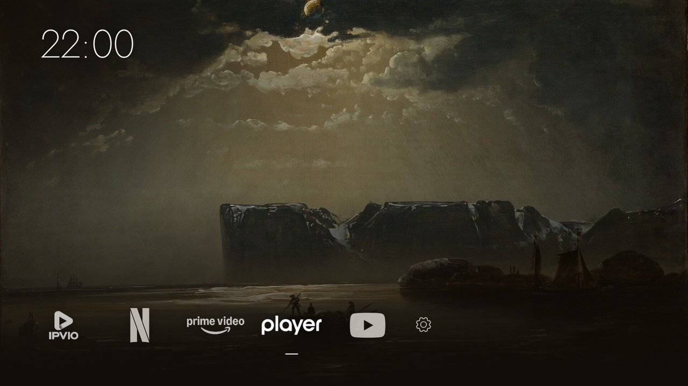

# Lightkeeper for Fire TV

A calm, ad-free Home screen for Amazon Fire TV (Fire TV Launcher): a clock, the weather, a row of your apps and a
painting of the sea. No banners, no autoplaying trailers, no sponsored rows.



This is an unofficial port of **[Lightkeeper](https://github.com/chiotas/lightkeeper)** by Francesco
Gola, the Home screen for LG TVs on webOS, to Fire TV. Lightkeeper's own web app runs unchanged in a
WebView; this app replaces what webOS and Lightkeeper's Node server did on the TV. It is not
affiliated with Lightkeeper, LG or Amazon.

## What you get

- **Lightkeeper's Home, as on webOS**: clock (six typefaces, 12/24 h), weather from Open-Meteo,
  up to 50 tiles shown as names, white logos or app icons, one or two rows, 18 sea paintings
  (a new one each time the screen comes on, if you like) or your own pictures.
- **Settings from your phone** at `http://<fire-tv-ip>:8090`, or from the gear on the Home itself,
  with an optional PIN.
- **Home Assistant**: values beside the clock, and tiles that switch a light or run a scene.
- **The Home button opens Lightkeeper**: Fire OS lets no app replace its launcher, so Lightkeeper
  watches for Fire TV's Home and steps in front of it (Amazon's Home shows for about a second first).
- **Down on the tile row** opens [Projectivy Launcher](https://github.com/spocky/miproja1) if it is
  installed, for every app you have; otherwise Fire TV's own Home.

Not available on Fire TV, and hidden from the settings: the open apps button (Fire OS lets no app
list or close others), GlassHouse remote keys, TV inputs, the screen saver pause and in-app updates.

## Install

You need a Fire TV with Fire OS 7 or 8, and once, a computer with
[adb](https://developer.android.com/tools/releases/platform-tools) on the same network.
Tested on a Fire TV Stick 4K Max (2nd gen), Fire OS 8.1.8.5.

1. **Turn on developer options.** Settings → My Fire TV → About → click the device name seven
   times. Then My Fire TV → Developer options → turn on **ADB debugging**, and allow
   **Install unknown apps** for Downloader.
2. **Install the APK.** In the [Downloader](https://www.aftvnews.com/downloader/) app, enter the
   code **`7172192`** and install it. The code always loads the latest release
   (`https://github.com/FR33M0N7/lightkeeper-firetv/releases/latest/download/lightkeeper-firetv.apk`).
   Or from the computer:
   `adb connect <fire-tv-ip>:5555 && adb install lightkeeper-firetv.apk`
3. **Let it take the Home button.** From the computer (accept the "Allow USB debugging?" prompt
   on the TV, ticking *Always allow*):

   ```sh
   adb connect <fire-tv-ip>:5555
   adb shell pm grant local.lightkeeper.firetv android.permission.READ_LOGS
   adb shell appops set local.lightkeeper.firetv SYSTEM_ALERT_WINDOW allow
   ```

   The first lets Lightkeeper see Fire TV's Home being opened; the second lets it open itself
   from the background. Both stay until the app is uninstalled. Keep ADB debugging on.
4. **Open Lightkeeper** from Your Apps once, then press Home. Choose your tiles with the gear,
   or from your phone at `http://<fire-tv-ip>:8090`.

After a cold start (a power cut), Fire OS takes a minute or two to start Lightkeeper's service;
until then Home goes to Amazon's screen.

## Other Android TV and Google TV devices

Lightkeeper runs on any Android TV or Google TV device with Android 7.1 or later (Chromecast with
Google TV, NVIDIA Shield, Xiaomi Mi Box, Onn, projectors and TVs with Android TV). The Home screen,
tiles, settings, phone settings page and Home Assistant work the same. Only step 3 above, taking
over the Home button, is Fire TV's: those devices let you **make Lightkeeper the default Home app**
instead, which is better: Home opens it directly, with no Amazon screen first. Not tested beyond
Fire TV, so please report how it goes.

1. **Install the APK**: turn on Developer options (Settings → Device Preferences → About → click
   *Build* seven times), turn on **USB debugging** (and Network debugging where offered), then
   `adb connect <tv-ip>:5555 && adb install lightkeeper-firetv.apk`; or use Downloader or a file
   manager with *Install unknown apps* allowed (Downloader code **`7172192`**).
2. **Make it the Home app**, the first of these that works:
   - **Android TV** (the older blue/grey Home): press Home and pick Lightkeeper when asked, or
     Settings → Apps → Default apps → Home app → Lightkeeper. With adb:
     `adb shell cmd package set-home-activity local.lightkeeper.firetv/.MainActivity`
   - **Google TV** (no Home app choice in Settings): set it with adb as above; if the Google TV Home
     still comes back, turn it off, at your own risk:
     `adb shell pm disable-user --user 0 com.google.android.apps.tv.launcherx`
     (and `com.google.android.tungsten.setupwraith` if Home then shows a setup screen). Undo with
     `adb shell pm enable <package>`; a factory reset also undoes it.
3. The `READ_LOGS` and `SYSTEM_ALERT_WINDOW` steps are not needed there; Lightkeeper's Home-button
   watcher only looks for Fire TV's launcher and stays idle elsewhere.
4. **Down on the tile row** opens Projectivy Launcher if installed. Without it, it does nothing on
   these devices (it opens Fire TV's Home on a Fire TV), so install Projectivy, or keep the apps
   you use as tiles.

## Apps that go well with it

- **[IPVIO Stream](https://github.com/Emrodev/IPVIO-Stream)**: a great IPTV player for Fire TV
  and Android TV. Free and open source, no account, bring your own playlist; skip intro,
  IMDb/Rotten Tomatoes ratings and profiles. Its tile shows a clean white logo on Lightkeeper's row.
- **[Projectivy Launcher](https://github.com/spocky/miproja1)** (APKs under its Releases): what Down on the tile row opens,
  for the apps you don't keep as tiles.

## Build from source

```sh
./sync-assets.sh          # fetches Lightkeeper (pinned tag) and puts its web app in the assets
./gradlew assembleRelease # JDK 17, Android SDK 34
adb install -r app/build/outputs/apk/release/app-release.apk
```

`UPSTREAM_REF=<tag> ./sync-assets.sh` builds against another Lightkeeper version. The release
build is signed with your local debug key; an update must be signed with the same key, or
uninstall first (which resets the settings).

### How it works

| Lightkeeper on webOS | Here |
| --- | --- |
| `index.html`, `logos.js`, `settings.html` | unchanged, in a WebView ([`sync-assets.sh`](sync-assets.sh)) |
| `PalmServiceBridge` / Luna calls | [`shim/android-shim.js`](shim/android-shim.js) and `MainActivity`'s JavaScript bridge |
| `service/server.js` (Node) | [`Server.java`](app/src/main/java/local/lightkeeper/firetv/Server.java), `Store`, `Ha`, `Http`: the same API on port 8090 |
| `applicationManager` | [`Apps.java`](app/src/main/java/local/lightkeeper/firetv/Apps.java): Android's launcher apps and icons |
| GlassHouse's Home key filter | [`HomeKey.java`](app/src/main/java/local/lightkeeper/firetv/HomeKey.java): logcat watcher |
| webOS app ids → logos | [`shim/fire-logos.js`](shim/fire-logos.js): Fire TV package names |

Logs: `adb logcat -s Lightkeeper`.

## Credits and licence

Lightkeeper and its web app © Francesco Gola, MIT. The background paintings are public domain or
openly licensed, credited in [Lightkeeper's README](https://github.com/chiotas/lightkeeper#readme)
and in the settings page. The *Godrevy Lighthouse* photograph is not included: its licence covers
Lightkeeper itself only. The Fire TV port is MIT too, see [LICENSE](LICENSE).
